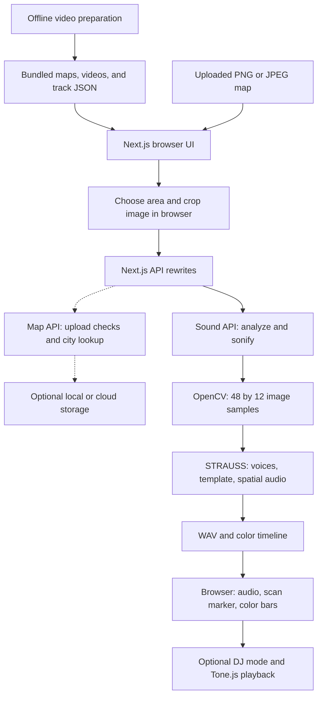

# Lychee Juicebox

**An Earth map becomes a sound you can explore.** Lychee Juicebox is Team Lychee's 2026 NASA Space Apps project. Visitors choose a supplied or uploaded map, select an area, and hear a scan of its rendered colors. The project treats the image as an artistic input; it does not convert the map back into measured geophysical values.

This is a **parent repository**. It pins two independent Git repositories as submodules. The applications stay in the original repositories, and any existing deployment connections remain unchanged.

| Submodule | Contains | Pinned revision |
| --- | --- | --- |
| [`web-and-map-api/`](https://github.com/Mretmna/team-lychee-nasaspaceapps-27) | Next.js frontend, FastAPI map service, bundled media, offline video preparation | [`1ff8811`](https://github.com/Mretmna/team-lychee-nasaspaceapps-27/commit/1ff881180fffbbdafad90fb4bf5aa16ded97bec3) |
| [`sound-api/`](https://github.com/Mretmna/team-lychee-nasaspaceapps-backend-27) | FastAPI image analysis and STRAUSS audio renderer | [`d6c06d3`](https://github.com/Mretmna/team-lychee-nasaspaceapps-backend-27/commit/d6c06d3c3e5ed13066e3f48e0385e9050cd46863) |

## At a glance



1. **Sources:** The Next.js app serves bundled Earth images, two videos and their track JSON. An offline preparation script created the ocean video features. Visitors can also upload a PNG/JPEG global map or GeoJSON points; the points appear as locations rather than becoming sound themselves.
2. **Selection:** In the browser, the visitor chooses a map, place, circle/square/full-map area, scan path, sound template, Normal/3D/8D listening mode and duration. Canvas code crops the selected image. For an animated choice, it crops the first video frame for the sound request.
3. **Map service:** A separate FastAPI map API validates prepared uploads and resolves city names. Its map-storage endpoint can use local files or optional Cloud Storage, but the current dashboard does not call that storage endpoint. Saved areas and accessibility preferences stay in the visitor's browser.
4. **Sound service:** By default, the browser reaches a separate FastAPI sound API through Next.js rewrites. `GET /templates` fills the chooser; `POST /analyze` returns the color-voice timeline; `POST /sonify` returns the finished WAV. The analysis graph has a browser fallback, but audible playback requires the WAV response.
5. **Synthesis:** The sound API validates and decodes the selected image, samples it at **48 scan positions × 12 bands**, and maps brightness, hue, saturation and band position to four synthesized voices. STRAUSS renders the chosen palette with optional spatial stereo; 8D adds a moving headphone effect. The API returns 16-bit PCM audio at 22,050 Hz.
6. **Playback:** The frontend plays the WAV while synchronizing the visible scan marker, video display and color bars to playback time. DJ mode scrubs the audio; an optional Tone.js mode reinterprets the WAV as instruments in the browser.

The parent repository only pins the two child repositories and documents them; it is not a runtime service. The map and sound APIs are separate processes. The moving video does **not** continuously generate new audio from every frame: the current sound represents its first selected frame. See [Architecture](docs/ARCHITECTURE.md) for request timing, state, storage and failure behavior.

## Documentation

| Guide | What it covers |
| --- | --- |
| [Architecture](docs/ARCHITECTURE.md) | Components, request sequence, state, persistence, runtime boundaries |
| [Maps and data](docs/MAPS_AND_DATA.md) | Map sources, geographic selection, upload rules, video feature pipeline, provenance |
| [Sonification](docs/SONIFICATION.md) | Image sampling, color-to-sound mapping, templates, spatial audio, DJ and instrument modes |
| [API and operations](docs/API_AND_OPERATIONS.md) | Endpoint contracts, environment variables, local development, verification, deployment boundaries |

The source repositories retain their own focused documentation: [web/map README](https://github.com/Mretmna/team-lychee-nasaspaceapps-27/blob/1ff881180fffbbdafad90fb4bf5aa16ded97bec3/README.md), [ocean data methodology](https://github.com/Mretmna/team-lychee-nasaspaceapps-27/blob/1ff881180fffbbdafad90fb4bf5aa16ded97bec3/backend/docs/data-methodology.md), and [sound API README](https://github.com/Mretmna/team-lychee-nasaspaceapps-backend-27/blob/d6c06d3c3e5ed13066e3f48e0385e9050cd46863/backend/README.md). This parent guide describes the **pinned code** and resolves historical differences between those documents and the current UI.

## Clone and run

```sh
git clone --recurse-submodules https://github.com/Mretmna/lychee-juicebox.git
cd lychee-juicebox
```

If the parent is already cloned, run `git submodule update --init --recursive`. Start the map API on port 8000, the sound API on port 8001, and Next.js on port 3000 using the commands in [API and operations](docs/API_AND_OPERATIONS.md#local-development). The homepage is `/`; the visitor tutorial is `/tutorial`; FastAPI's interactive references are available at `/docs` on each local API port.

## Repository rule

Make code changes and commits **inside the relevant child repository**. Commit the updated submodule pointer in this parent only when you want it to reference that child revision. This parent contains documentation and Git references; it has no build or deployment pipeline. No Vercel, Cloud Run, domain, or DNS settings are changed here.
