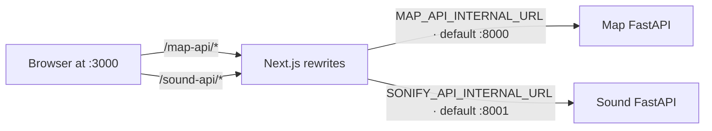

# APIs, configuration and operations

This guide is for the two source repositories pinned by the [parent README](../README.md). It documents what the code expects; it does **not** change or assume the state of any live deployment.

## Service interfaces

The default local topology is Next.js on **3000**, the map API on **8000**, and the sound API on **8001**. The browser normally uses relative paths on the Next.js origin:



[Next.js rewrite source](https://github.com/Mretmna/team-lychee-nasaspaceapps-27/blob/1ff881180fffbbdafad90fb4bf5aa16ded97bec3/frontend/next.config.ts) retains the path after each prefix. API documentation is reliably available by opening **the services directly** at `http://127.0.0.1:8000/docs` and `http://127.0.0.1:8001/docs`; the sound service also serves a standalone `/demo`.

### Map API

[Implementation](https://github.com/Mretmna/team-lychee-nasaspaceapps-27/blob/1ff881180fffbbdafad90fb4bf5aa16ded97bec3/backend/server/main.py)

| Route | Purpose | Used by active frontend? |
| --- | --- | --- |
| `POST /api/selection` | Validate a GeoJSON Point FeatureCollection against selected circle/square/full region; return received point count | Yes, for a user GeoJSON upload |
| `POST /api/raster-selection` | Validate a selected PNG and geographic metadata; return dimensions and covered-pixel count | Yes, for a user PNG/JPEG map after browser crop |
| `GET /api/locations?city=…&country=…` | Resolve a city through Open-Meteo geocoding | Yes, for city lookup |
| `POST /api/maps` | Persist a PNG/JPEG/WebP or supported GeoJSON document with area metadata | No; available for separate clients |
| `GET /maps/{id}` | Retrieve a persisted map | No; available for separate clients |
| `POST /sonify` | Produce a simple eight-second mono WAV from a validated crop | No; active audio comes from the separate STRAUSS sound API |

`/api/raster-selection` requires multipart `file`, `latitude`, `longitude`, `radius_km`, `west`, `east`, `south`, `north` and `region_shape`. It accepts a cropped **PNG** smaller than 10 MiB and no larger than 1,024 × 1,024. It validates coordinate ranges, full-world bounds and the shape; for circles, nontransparent pixels must fall inside the selected radius. The browser turns an original JPEG into a PNG crop before posting. `/api/selection` accepts JSON with the center, `radiusKm`, `regionShape` and `data` FeatureCollection (up to 10,000 point features at the model boundary). `/api/maps` has a separate 10 MiB upload limit and optional Cloud Storage persistence.

### Sound API

[Route implementation](https://github.com/Mretmna/team-lychee-nasaspaceapps-backend-27/blob/d6c06d3c3e5ed13066e3f48e0385e9050cd46863/backend/app.py) · [Algorithm](SONIFICATION.md)

| Route | Purpose |
| --- | --- |
| `GET /health` | Process status and STRAUSS engine version |
| `GET /templates` | Default template and current palette catalog |
| `GET /sources` | Bundled NASA fallback metadata and credits |
| `GET /sources/nasa-ocean/image` | Bundled fallback JPEG |
| `GET /legend/{red|green|blue|neutral}` | Two-second isolated voice preview WAV |
| `POST /analyze` | Image metadata, provenance, mapping explanation and 49-frame voice timeline |
| `POST /sonify` | Complete `audio/wav` response |
| `GET /demo` | Standalone upload and scan demo; omitted from OpenAPI schema |

`/analyze` and `/sonify` share these options: optional multipart `file`; `duration_seconds` **2–30** (default 12); `scan_mode` `clockwise|linear|circle_outward|circle_inward`; `region_shape` `circle|square|full`; `sound_template` `original|orchestral|medieval|modern|heavenly|cosmic_remnant`; `spatial_audio`; `eight_d_audio`; and a comma-separated `voices` subset of red, green, blue and neutral. `/sonify` additionally accepts `normalize`, true by default. The frontend offers 10, 20 and 30 seconds and sends its cropped file, rather than relying on the NASA fallback.

A successful `/sonify` response is a signed 16-bit PCM WAV at **22,050 Hz**. Headers report template, scan/shape, spatial mode, source, input SHA-256, duration, mapping version, normalization and event count. Treat non-2xx responses as JSON errors, not audio files. A direct request using the fallback image can be tested with:

```sh
curl -f -X POST 'http://127.0.0.1:8001/sonify?duration_seconds=10&scan_mode=clockwise' -o /tmp/lychee-test.wav
```

## Configuration

| Variable | Process | Meaning and default |
| --- | --- | --- |
| `MAP_API_INTERNAL_URL` | Next.js server/build | Upstream base for `/map-api/*`; defaults to `http://127.0.0.1:8000` |
| `SONIFY_API_INTERNAL_URL` | Next.js server/build | Upstream base for `/sound-api/*`; defaults to `http://127.0.0.1:8001` |
| `NEXT_PUBLIC_MAP_API_URL` | Browser bundle | Optional direct map API base; defaults to `/map-api` |
| `NEXT_PUBLIC_SONIFY_API_URL` | Browser bundle | Optional direct sound API base; defaults to `/sound-api` |
| `NEXT_PUBLIC_GOOGLE_MAPS_API_KEY` | Browser bundle | Optional detailed Google map for circle selection; no key uses Three.js globe |
| `NEXT_PUBLIC_DEMO_YOUTUBE_URL` | Browser bundle | Optional homepage video URL or ID |
| `MAP_ALLOWED_ORIGINS` | Map API | Comma-separated browser origins allowed by CORS; defaults include local development origins |
| `MAP_UPLOAD_BUCKET` | Map API | Optional Google Cloud Storage bucket for `/api/maps`; otherwise files go to local disk |
| `CORS_ORIGINS` | Sound API | Comma-separated browser origins allowed by CORS; defaults include local development origins |
| `PORT` | Container runtime | Docker commands bind to this value, defaulting to 8080; local commands below explicitly use 8000/8001 |

Use public `NEXT_PUBLIC_*` values only for browser-safe configuration. The upstream rewrite variables belong to the Next.js process. When Next.js runs on a separate host, leaving the internal URLs at `127.0.0.1` makes them point to **that host**, not the APIs; supply reachable service URLs there. With same-origin rewrites, the browser itself does not need cross-origin access to the APIs. If using direct browser API URLs, configure the API CORS origins for the frontend domain. No credentials or private keys should be placed in `NEXT_PUBLIC_*` values.

## Local development

After `git clone --recurse-submodules`, use three terminals. Python **3.12** is a compatible choice for both services; Node must satisfy the frontend's `>=20.9.0` engine setting.

**Terminal 1 — map API** (a temporary venv keeps generated dependencies out of the child Git repo):

```sh
python3.12 -m venv /tmp/lychee-map-venv
/tmp/lychee-map-venv/bin/python -m pip install -r web-and-map-api/backend/server/requirements.txt
cd web-and-map-api/backend
/tmp/lychee-map-venv/bin/python -m uvicorn server.main:app --reload --host 127.0.0.1 --port 8000
```

**Terminal 2 — sound API:**

```sh
cd sound-api
python3.12 -m venv .venv-api
.venv-api/bin/python -m pip install -r requirements-api.txt
.venv-api/bin/python -m uvicorn backend.app:app --reload --host 127.0.0.1 --port 8001
```

**Terminal 3 — frontend:**

```sh
cd web-and-map-api/frontend
npm ci
npm run dev
```

Open `http://localhost:3000/`. To see the full flow, choose a built-in still map and generate a short sound; then test an uploaded PNG/JPEG. The first exercise needs the sound API. Preparing an uploaded map also needs the map API. The frontend and each FastAPI process have separate logs.

## Verification

| Area | Relevant checks |
| --- | --- |
| Frontend | From `web-and-map-api/frontend`: `npm run typecheck`, `npm run lint`, `npm run test`, `npm run build` |
| Sound API | From `sound-api`: `.venv-api/bin/python -m pytest backend/tests -q` |
| Offline ocean pipeline | From `web-and-map-api/backend`, with `requirements-data.txt` installed in an isolated Python environment: `python -m unittest discover -s scripts -p 'test_*.py'` and `python scripts/extract_features.py --validate-only` |
| Map API | Open `/docs` on port 8000 and exercise `/api/selection` and `/api/raster-selection`; the pinned repo does not include a dedicated map-route test suite |

Frontend typecheck/build and the 16 frontend tests passed at the pinned revision; all 60 sound API tests passed when these guides were prepared. Lint passed with two pre-existing Next.js image-element optimization warnings. The parent contains documentation only; it has no application build.

## Limits and failure modes

- **Map upload:** up to 10 MiB. Prepared raster PNGs are validated against coordinates, bounds, dimensions and circle coverage. Invalid input returns 4xx; failed city lookup can return 502. Local stored-map files are not durable on an ephemeral host.
- **Sound upload:** 10 MiB image, 11 MiB multipart body, 16 megapixels, 8,192 pixels per side. Unsupported or corrupt formats return 415/422; oversize input returns 413. An image without audible features returns 422.
- **Sound concurrency:** an in-process lock allows one decode/render request at a time **per worker**; another request can receive 503 with `Retry-After: 2`. There is no queue or persistent job state. A host may impose further request-time or memory limits.
- **Frontend request:** sound generation is aborted after 60 seconds. Analysis failure leaves the local color graph available; sound failure produces a timed silent scan with an error. Browser autoplay may require pressing Play explicitly.
- **Public API access:** CORS is an origin rule, not authentication. The application code has no user accounts or built-in rate limiter. Consider gateway limits if making these services public.

## Deployment boundary and submodule maintenance

The parent repository is **not** connected to a runtime or domain. The checked-in child `vercel.json` files set `git.deploymentEnabled` to `false`; deployment behavior should be checked in the hosting project before relying on an automatic push-to-deploy workflow. A separate [child deployment guide](https://github.com/Mretmna/team-lychee-nasaspaceapps-27/blob/1ff881180fffbbdafad90fb4bf5aa16ded97bec3/DEPLOY.md) describes one possible Cloud Run/Firebase topology, while the frontend can also be hosted on Vercel. Those instructions are implementation options, not a claim about the current live environment. **No hosting, domain, DNS or deployment settings were changed to create this documentation.**

When a child repository moves forward, update its pointer deliberately:

```sh
git -C web-and-map-api fetch origin main
git -C web-and-map-api checkout origin/main
git add web-and-map-api
git commit -m 'Update web and map API submodule'
git push
```

Repeat with `sound-api` when needed. A fresh clone should use `--recurse-submodules`; an existing clone uses `git submodule update --init --recursive`. The parent pins **commits**, so a child push does not automatically change what the parent points to.
