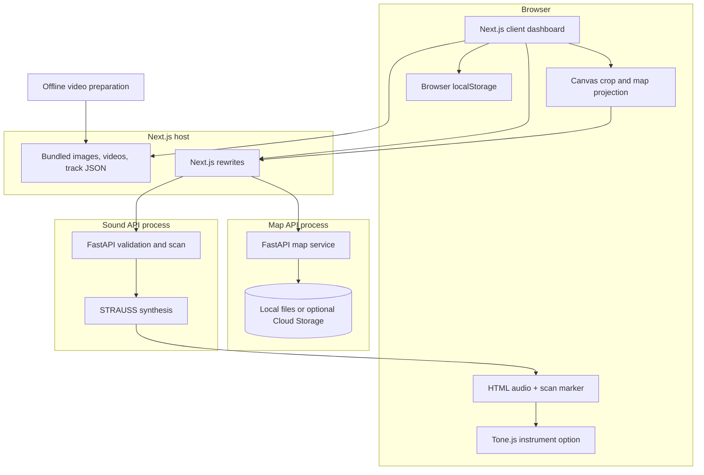
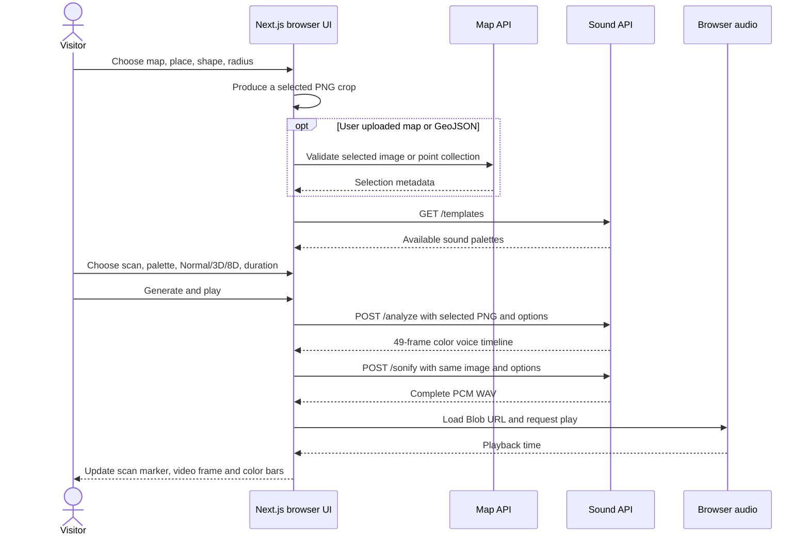

# System architecture

This document describes the code pinned by the parent repository, not an inferred live hosting configuration. [README](../README.md) gives the overview; [API and operations](API_AND_OPERATIONS.md) contains commands and environment variables.

## Runtime boundaries

| Part | Responsibility | Main code |
| --- | --- | --- |
| Next.js App Router | `/` dashboard and `/tutorial`, bundled assets, browser state and controls | [page](https://github.com/Mretmna/team-lychee-nasaspaceapps-27/blob/1ff881180fffbbdafad90fb4bf5aa16ded97bec3/frontend/app/page.tsx), [dashboard](https://github.com/Mretmna/team-lychee-nasaspaceapps-27/blob/1ff881180fffbbdafad90fb4bf5aa16ded97bec3/frontend/components/jukebox-dashboard.tsx) |
| Browser map preparation | Latitude/longitude selection, 2D crop, circular display projection, GeoJSON filtering | [geo library](https://github.com/Mretmna/team-lychee-nasaspaceapps-27/blob/1ff881180fffbbdafad90fb4bf5aa16ded97bec3/frontend/lib/geo.ts) |
| Browser playback | Sound request, WAV playback, synchronized video and marker, DJ mode, live color bars | [rotation visualization](https://github.com/Mretmna/team-lychee-nasaspaceapps-27/blob/1ff881180fffbbdafad90fb4bf5aa16ded97bec3/frontend/components/rotation-visualization.tsx) |
| Map API | Validates raster/point selections, resolves city names, optionally stores uploaded maps | [map server](https://github.com/Mretmna/team-lychee-nasaspaceapps-27/blob/1ff881180fffbbdafad90fb4bf5aa16ded97bec3/backend/server/main.py) |
| Sound API | Validates still images, produces an explainable color timeline and a rendered WAV | [sound routes](https://github.com/Mretmna/team-lychee-nasaspaceapps-backend-27/blob/d6c06d3c3e5ed13066e3f48e0385e9050cd46863/backend/app.py), [imaging](https://github.com/Mretmna/team-lychee-nasaspaceapps-backend-27/blob/d6c06d3c3e5ed13066e3f48e0385e9050cd46863/backend/imaging.py), [audio](https://github.com/Mretmna/team-lychee-nasaspaceapps-backend-27/blob/d6c06d3c3e5ed13066e3f48e0385e9050cd46863/backend/audio.py) |
| Offline preparation | Decodes a NASA ocean clip and writes versioned JSON features and validation artifacts | [extractor](https://github.com/Mretmna/team-lychee-nasaspaceapps-27/blob/1ff881180fffbbdafad90fb4bf5aa16ded97bec3/backend/scripts/extract_features.py) |

The map and sound APIs are **separate FastAPI processes**. The browser defaults to same-origin `/map-api/*` and `/sound-api/*` URLs. [Next.js rewrites](https://github.com/Mretmna/team-lychee-nasaspaceapps-27/blob/1ff881180fffbbdafad90fb4bf5aa16ded97bec3/frontend/next.config.ts) forward those paths to the configured upstream services. A browser-facing URL can override either prefix, in which case the API's CORS settings matter. The parent repository does not sit in the request path.

## Active visitor flow

The analysis request is supplementary: the UI can use a browser-computed color timeline if it fails. The **sound request is required for audible WAV playback**. If it fails, the frontend starts a timed visual scan and shows an error stating that it is playing without generated sound. Browser autoplay can also block the initial `play()` call; the visible audio controls then let the visitor start it manually.

## State and invalidation

The dashboard owns the selected dataset, upload/default mode, location, region shape, 10/20/30 second duration, scan path, sound template and Normal/3D/8D mode. It starts at **North Atlantic (38° N, 35° W), 2,500 km radius**, Actual World, circle, clockwise, Original colors and Normal. A crop is considered current only when its shape and location still match the active selection; a changed map or area requires a new crop. The sound component is keyed by source, crop, shape and sound settings, so changing them clears obsolete playback state. Object URLs for crops and WAVs are revoked during cleanup.

The template list comes from `GET /templates`, allowing backend palettes to populate the chooser. The `cosmic_remnant` selection also switches the frontend scan path to center-outward; visitors may change the path afterward. The backend remains authoritative for accepted template identifiers.

Location can come from the globe, an optional Google Maps circle picker, presets, typed coordinates, or city lookup. Saved areas and accessibility preferences are stored in the **visitor's localStorage**, not a shared account. The map API's optional `/api/maps` endpoint has its own file/Cloud Storage persistence but is **not called by the current dashboard upload flow**.

## Animated-map behavior

Two choices have bundled video and versioned track JSON: precipitation and North Pacific color. [Track loading](https://github.com/Mretmna/team-lychee-nasaspaceapps-27/blob/1ff881180fffbbdafad90fb4bf5aa16ded97bec3/frontend/lib/track.ts) validates identifiers, URLs, credits, monotonically increasing timestamps and normalized feature values. If a production JSON file is missing, a clearly labeled synthetic fixture can load; the active sound button is disabled for a synthetic animated track.

For the **current active dashboard**, sound generation seeks the video to time zero, draws that first frame, crops the selected area, and sends that still PNG to the sound API. During playback, the video display is positioned according to the WAV's playback fraction. The existing `colorWarmth`, `motion` and `variation` timeline is loaded and available in code, but it is **not used to generate the active WAV**. An older [browser Web Audio engine](https://github.com/Mretmna/team-lychee-nasaspaceapps-27/blob/1ff881180fffbbdafad90fb4bf5aa16ded97bec3/frontend/lib/audio-engine.ts) and [player](https://github.com/Mretmna/team-lychee-nasaspaceapps-27/blob/1ff881180fffbbdafad90fb4bf5aa16ded97bec3/frontend/components/jukebox-player.tsx) remain in the repository and have tests, but `/` mounts `JukeboxDashboard`, not that player.

This distinction matters when interpreting a moving map: the soundtrack expresses colors in one chosen frame while the video supplies a synchronized visual journey. It is not a continuous sonification of changing scientific observations across the clip.

## Trust, storage and operational boundaries

- Uploaded raster preparation runs in the browser; selected PNGs are sent to the map API for validation and to the sound API for rendering. The sound API does not persist uploads or WAVs. The browser holds temporary `Blob` URLs for playback and download.
- The map API can save files to local disk or, when `MAP_UPLOAD_BUCKET` is set, to Cloud Storage. Local disk is ephemeral on many managed hosts. The active `Prepare selected area` UI only validates; it does not call the storage endpoint.
- The sound API bounds multipart size and decoded dimensions, serializes decode/render work **per process**, and returns 503 when its render slot is busy. It has no queue or database. See [API and operations](API_AND_OPERATIONS.md#limits-and-failure-modes).
- The sound is synthesized from rendered pixels. Legends, coastlines, labels and compression artifacts can affect it. A map title or color key does not change the mapping into physical units. See [Maps and data](MAPS_AND_DATA.md#interpretation-and-provenance).
- The layout includes a tutorial and a site tour, keyboard access, skip links, reduced-motion and contrast preferences, an accessible coordinate route, status announcements and a polar-view warning. [Site help](https://github.com/Mretmna/team-lychee-nasaspaceapps-27/blob/1ff881180fffbbdafad90fb4bf5aa16ded97bec3/frontend/components/site-help.tsx) persists preferences locally.

## Where to change behavior

| Goal | Change here |
| --- | --- |
| Add a built-in map | Frontend `map-chooser.tsx`, `rotation-visualization.tsx` dataset paths and `public/media/maps/`; add a source/legend record |
| Change geographic cropping | Frontend `lib/geo.ts`; keep map API validation compatible |
| Change sound palette | Sound API `backend/audio.py` and `backend/app.py` template identifier; frontend discovers catalog dynamically |
| Change color-to-note mapping or scan sampling | Sound API `backend/imaging.py`; update analysis tests and visual marker alignment |
| Change scan marker, DJ mode, or WAV playback | Frontend `rotation-visualization.tsx` |
| Change historical video feature extraction | Web/map repo `backend/scripts/` and `backend/docs/data-methodology.md` |
| Change deployment | The relevant child repository and hosting project; this parent repository does not deploy |
