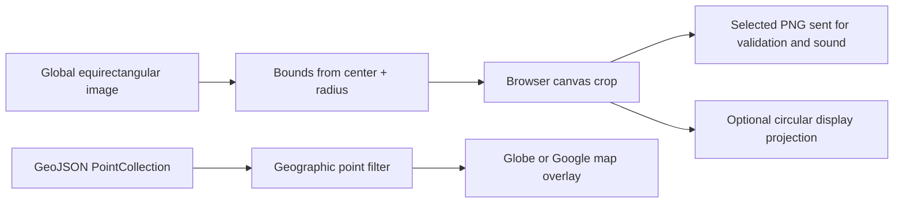

# Maps, regions and data lineage

Lychee Juicebox listens to **rendered map imagery**. The geographic controls decide which pixels are included; they do not query a scientific data cube by coordinate. [Architecture](ARCHITECTURE.md) describes the runtime flow, and [Sonification](SONIFICATION.md) describes what happens to the selected pixels.

## Map choices in the current UI

The default chooser has three Earth/motion choices and eight detailed still maps. The detailed group is marked **Recommended** because its source images are generally higher resolution; the label is a UI suggestion, not a scientific quality rating.

| Choice | Bundled input | Active sound input |
| --- | --- | --- |
| Actual World | `public/earth-atmos-2048.jpg`, a Three.js Earth example texture | Selected still-image crop |
| Global Precipitation | `public/media/precipitation.webm` and `public/data/precipitation.json` | Selected crop of the **first** video frame |
| North Pacific Color | `public/media/ocean.mp4` and `public/data/ocean.json` | Selected crop of the **first** video frame |
| Sea Currents & Temperatures | `public/media/maps/sea-currents.jpg` | Selected still-image crop |
| Precipitation & Clouds | `public/media/maps/precipitation-clouds.jpg` | Selected still-image crop |
| Near Surface Temperature | `public/media/maps/surface-temperature.jpg` | Selected still-image crop |
| Near Surface Humidity | `public/media/maps/surface-humidity.png` | Selected still-image crop |
| Near Surface Ozone | `public/media/maps/surface-ozone.jpg` | Selected still-image crop |
| Near Surface Wind Speed | `public/media/maps/surface-wind-speed.jpg` | Selected still-image crop |
| Carbon Monoxide | `public/media/maps/carbon-monoxide.jpg` | Selected still-image crop |
| Nitrogen Oxides | `public/media/maps/nitrogen-oxides.jpg` | Selected still-image crop |

The eight detailed still maps have separate bundled legend images, shown by the chooser. The active sound path samples pixels from the selected image, including any legend or label that remains in its crop; it does **not** decode a legend into scientific units. The current map catalog records labels, paths and approximate image resolutions, but it does not carry a full provenance record for every detailed still map. Record source URL, date, credit, palette and license for each image before presenting those maps as reproducible scientific datasets. [Map catalog source](https://github.com/Mretmna/team-lychee-nasaspaceapps-27/blob/1ff881180fffbbdafad90fb4bf5aa16ded97bec3/frontend/components/map-chooser.tsx)

## Geographic selection

A source raster is assumed to cover longitude **−180° to +180°** and latitude **+90° to −90°** in a 2:1 equirectangular layout. The browser maps selected latitude/longitude bounds into image coordinates, wraps longitude across the antimeridian, clamps at the poles, and bilinearly samples source pixels. It does not read embedded georeferencing metadata. An arbitrary photograph or regional map will therefore produce a geographically misleading crop unless first transformed into the expected world layout.

| Shape | Inclusion rule | Display |
| --- | --- | --- |
| Circle | Great-circle distance from chosen center ≤ radius, using Earth radius 6,371.0088 km | Transparent outside the selected circle; a separate 960 × 960 projected image can be used for the visible circular preview |
| Square | Latitude/longitude bounds derived from the center and angular radius | Square image; this is an image-space region, not a geodesic square |
| Entire map | World bounds −180°…180°, −90°…90° | Whole source image scaled to fit the output cap |

The radius control allows **10–10,000 km**, defaults to **2,500 km**, and shows a quality warning below 500 km. The globe view warns when the selected latitude reaches 80° north or south because polar views can stretch. The canvas crop is bounded to **1,024 pixels per side**; built-in and uploaded images are accepted up to **8,192 × 4,096 pixels** by this browser crop function. The browser can upscale a narrow region for display, but cannot invent source detail. Circle display reprojection changes only the preview; the original cropped PNG is sent to the sound API. [Cropping and projection source](https://github.com/Mretmna/team-lychee-nasaspaceapps-27/blob/1ff881180fffbbdafad90fb4bf5aa16ded97bec3/frontend/lib/geo.ts)

A place can be chosen on the Three.js globe, typed as coordinates, selected from presets, or found by city name through the map API's Open-Meteo geocoding request. With a browser Google Maps key, a detailed Google map is used for **circle** selection; square and entire-map views use the globe. Saved areas live in localStorage on that browser. Google Maps is a location aid, not the source image sent for sonification.

## Bring your own map

The current upload UI accepts a **PNG or JPEG global raster up to 10 MiB**, plus GeoJSON Point FeatureCollections for visual points. It validates the raster file name and MIME hint in the browser, crops it locally, and posts the selected PNG with center, radius, shape and bounds to `POST /api/raster-selection`. The map API checks the values, PNG dimensions (1–1,024 each), shape and visible pixels. The sound API separately validates the actual uploaded raster bytes before rendering. [Upload UI](https://github.com/Mretmna/team-lychee-nasaspaceapps-27/blob/1ff881180fffbbdafad90fb4bf5aa16ded97bec3/frontend/components/map-upload.tsx) · [Map API](https://github.com/Mretmna/team-lychee-nasaspaceapps-27/blob/1ff881180fffbbdafad90fb4bf5aa16ded97bec3/backend/server/main.py)

GeoJSON point uploads are filtered to the selected circle/square/full region and submitted to `POST /api/selection` for validation. **Points are not converted into audio**; the UI says that a PNG or JPEG is needed for sound. This path supports point FeatureCollections, not arbitrary polygons or line features.

The map API also exposes `POST /api/maps`, which can store a PNG, JPEG, WebP or supported GeoJSON document and return a `/maps/{id}` URL. It uses local files by default or Google Cloud Storage when `MAP_UPLOAD_BUCKET` is set. **The current upload UI does not call this storage endpoint**; preparing a selected area does not create a persistent map record.

## Video track contract and offline preparation

The two animated choices bundle version-1 JSON track documents with `id`, `videoUrl`, `sourceUrl`, credits, duration, feature definitions and timestamped samples of `colorWarmth`, `motion` and `variation`, each normalized to `[0,1]`. [Track validator](https://github.com/Mretmna/team-lychee-nasaspaceapps-27/blob/1ff881180fffbbdafad90fb4bf5aa16ded97bec3/frontend/lib/track.ts) enforces the schema and interpolates sample values for the retained browser feature engine. The current active WAV path instead samples the first selected video frame, as explained in [Architecture](ARCHITECTURE.md#animated-map-behavior).

The North Pacific video comes from [NASA SVS 5101](https://svs.gsfc.nasa.gov/5101/). The checked-in preparation pipeline takes the first 30 seconds of the source, prepares a 1,280 × 640, 30 fps H.264 MP4 without audio, then samples a reviewed fixed North Pacific image region at 5 Hz. Its fixed mask removes much dark/neutral land imagery using a visual heuristic; this is **not** an authoritative land or ocean mask. The extracted scores are:

- `colorWarmth`: mean `(R − B + 1) / 2` within the mask; a color score, not temperature.
- `motion`: mean absolute RGB change from the previous sample divided by 0.05 and clipped to `[0,1]`; visual change, not current speed.
- `variation`: twice the root mean of the RGB channel variances; spatial color diversity, not climate variability.

The pipeline validates duration, frame timestamps, sample cadence, bounds, hashes and reproducibility against the final media. It runs **offline**, not during a visitor request or web build. See the [full methodology and provenance](https://github.com/Mretmna/team-lychee-nasaspaceapps-27/blob/1ff881180fffbbdafad90fb4bf5aa16ded97bec3/backend/docs/data-methodology.md). The precipitation video and track JSON reference [NASA SVS 4285](https://svs.gsfc.nasa.gov/4285/); inspect that document's credits and feature definitions before interpreting it. A missing production track may fall back to a labeled synthetic fixture, but the active animation sound button remains disabled for that fixture.

## Interpretation and provenance

- Audio carries the visible image's **RGB color, saturation, brightness and scan position**. It is neither recorded Earth audio nor a numeric measurement of temperature, precipitation, wind, currents, ozone or pollution.
- Palette changes, legends, labels, compression, image resolution and user crops change the sound. No inverse palette calibration or physical-unit lookup occurs.
- The bundled sound API fallback is a separate [NASA SVS 3912](https://svs.gsfc.nasa.gov/3912/) ocean still with a recorded SHA-256. The active frontend normally sends its own selected image instead of using that fallback. [Sound source metadata](https://github.com/Mretmna/team-lychee-nasaspaceapps-backend-27/blob/d6c06d3c3e5ed13066e3f48e0385e9050cd46863/backend/assets/nasa-ocean.json)
- User images are labeled user-provided and are never automatically credited to NASA.
- The 3D globe texture is from a [Three.js example](https://github.com/mrdoob/three.js/blob/dev/examples/textures/planets/earth_atmos_2048.jpg), not a live satellite feed.
