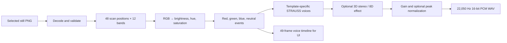

# How image becomes sound

The active sound path is a **server-rendered, image-based sonification**. The frontend sends a selected PNG to the sound API. The API decodes its pixels, scans a fixed grid, synthesizes voices with STRAUSS, and returns a complete WAV before playback starts. The sound is an artistic reading of the image, not measured audio from Earth.

## Input and validation

`POST /sonify` and `POST /analyze` accept an optional multipart `file`. With no file, the service uses its bundled NASA ocean still and verifies its recorded SHA-256. The current frontend normally **always supplies a selected image**. A supplied invalid or empty file is an error rather than a fallback.

The service accepts single-frame **PNG, JPEG, WebP, BMP and TIFF**. It checks actual bytes and decoded format rather than trusting the filename or declared MIME type. Limits are 10 MiB per image, 11 MiB for the whole multipart request, 16 megapixels and 8,192 pixels on either side. It rejects animations, multipage images and non-8-bit pixels; applies EXIF orientation; expands grayscale to RGB; and composites transparency onto black so transparent areas are silent. [Decoder](https://github.com/Mretmna/team-lychee-nasaspaceapps-backend-27/blob/d6c06d3c3e5ed13066e3f48e0385e9050cd46863/backend/imaging.py)

## Scan geometry

There are **48 time positions** and **12 bands** at every position. STRAUSS interpolates the band volumes between positions across the chosen 2–30 second duration. The UI offers 10, 20 and 30 seconds. The gold overlay is driven by audio playback time, so the visual scan follows the rendered WAV rather than a separate unsynchronized timer.

| Scan path | What is sampled | Visible marker |
| --- | --- | --- |
| `clockwise` | 48 rays, 7.5° apart, starting at 12 o'clock; each ray ends at the image rectangle edge and has 12 center-to-edge bands | Centered rotating line |
| `linear` | Image area-resized to 48 columns × 12 rows | Full-height line, left to right |
| `circle_outward` | 48 concentric rings from center to edge; 12 angular sectors per ring | Expanding circle for a circle region; expanding rectangle for square/full |
| `circle_inward` | Same rings or rectangular contours in reverse order | Contracting circle or rectangle |

Radial/contour bands use three bilinear subsamples to reduce aliasing. For square and entire-map regions, the center-out/in paths use **rectangular contours** to cover the whole image rather than discarding its corners. The `region_shape` parameter tells the backend which contour geometry to use. It does not add geographic meaning to pixels. [Scan implementation](https://github.com/Mretmna/team-lychee-nasaspaceapps-backend-27/blob/d6c06d3c3e5ed13066e3f48e0385e9050cd46863/backend/imaging.py)

## Color mapping

For each sampled cell, RGB channels are scaled to `[0,1]`. Brightness is `0.2126R + 0.7152G + 0.0722B`; OpenCV HSV supplies hue and saturation. Cells at or below `1/255` brightness are silent. Hue is blended circularly between three anchors: red at 0°, green at 120°, and blue at 240°. A yellow cell contributes red and green; purple contributes blue and red. The neutral voice receives `1 − saturation`, so gray is neutral rather than automatically red.

For each active voice, `event volume = brightness × voice strength / 12`. The 12-band base note scale runs from **C3 to D5**; the source row determines pitch. In the Original template, red is one octave below that scale, green and neutral use the base octave, and blue is one octave above it. Templates can change octave, harmonic partials and attack but **not** the pixel-to-voice formula. Higher pitch comes from the center for clockwise scans, the top for linear scans, and angular sector for circle scans. [Event mapping](https://github.com/Mretmna/team-lychee-nasaspaceapps-backend-27/blob/d6c06d3c3e5ed13066e3f48e0385e9050cd46863/backend/imaging.py) · [Synthesizer](https://github.com/Mretmna/team-lychee-nasaspaceapps-backend-27/blob/d6c06d3c3e5ed13066e3f48e0385e9050cd46863/backend/audio.py)

The mapping version is `color-voices-v1`. Every pixel used by the scan can contribute, including labels or legend colors. There is no scientific palette inversion, segmentation of land/water, or translation into physical units.

## Sound templates

`GET /templates` supplies the live catalog to the frontend. These are **synthesized approximations**, not recordings of named instruments. Each color uses sustained STRAUSS objects with up to three sine partials; volume changes as the scan advances.

| Template ID | Palette concept | Additional processing |
| --- | --- | --- |
| `original` | Rounded red bass, soft green midrange, blue bell-like tone, neutral sine | Baseline continuous voices |
| `orchestral` | Choir-like red, saxophone-like green, violin-like blue | Different partials, octaves and envelopes |
| `medieval` | Low horn-like red, lute-like green, reed-like blue | Different partials, octaves and envelopes |
| `modern` | Synth bass red, electric pad green, glassy lead blue | Different partials, octaves and envelopes |
| `heavenly` | Angelic choir red, floating strings green, crystal chimes blue, halo neutral | Three quiet delays soften the mix |
| `cosmic_remnant` | High neutral synth, piano-like blue, string-like green, brass-like red | Small bright/metallic accents; center cue with outward scan |

`cosmic_remnant` is a creative Earth-map analogy inspired by a [NASA Chandra Cassiopeia A sonification](https://chandra.si.edu/photo/2024/sonify9/). It does **not** use Chandra, Webb or Hubble measurements. Choosing it in the frontend initially selects `circle_outward` so the center cue is audible; the scan path remains editable. Exact partial ratios, attack times and octaves are in [SOUND_TEMPLATES](https://github.com/Mretmna/team-lychee-nasaspaceapps-backend-27/blob/d6c06d3c3e5ed13066e3f48e0385e9050cd46863/backend/audio.py).

## Normal, 3D and 8D

| UI choice | API options | Result |
| --- | --- | --- |
| Normal | `spatial_audio=false`, `eight_d_audio=false` | Centered **mono** WAV |
| 3D | `spatial_audio=true`, `eight_d_audio=false` | STRAUSS source positions rendered to **stereo**; movement follows scan geometry |
| 8D | `spatial_audio=true`, `eight_d_audio=true` | Stereo plus stronger scan-aligned panning and short cross-ear reflections |

For clockwise scans, screen angle and STRAUSS azimuth have opposite sign conventions; the backend reverses azimuth so the visible right-hand side is heard on the right. Left-to-right uses a direct left-to-right sweep. Expanding/contracting paths vary azimuth and polar position with ring extent and angular sector. The 8D option is a headphone-oriented stereo effect, **not** head-tracked spatial audio or a physical eight-channel surround format. [Spatial and 8D implementation](https://github.com/Mretmna/team-lychee-nasaspaceapps-backend-27/blob/d6c06d3c3e5ed13066e3f48e0385e9050cd46863/backend/audio.py)

All modes render 22,050 Hz signed 16-bit PCM WAV. A fixed 0.7 gain follows the STRAUSS mix. By default the final peak is scaled to 0.8 for audibility; this preserves relative levels **within** one map, but removes absolute loudness comparability **between** maps. API clients may request `normalize=false` to retain fixed-gain differences. The UI uses default normalization.

## Analysis, playback and interaction

`POST /analyze` returns image dimensions, provenance, mapping explanations, voice counts and a **49-frame** timeline: 48 scan positions plus a held endpoint. The frontend samples this timeline at the WAV's current playback fraction to show red, green, blue, neutral and brightness bars. If analysis is unavailable, a browser image sampler supplies a visual approximation. These bars are brightness-weighted color contributions **before** normalization, instrument envelopes and echoes; they are not acoustic loudness meters. [Browser analysis](https://github.com/Mretmna/team-lychee-nasaspaceapps-27/blob/1ff881180fffbbdafad90fb4bf5aa16ded97bec3/frontend/lib/voice-analysis.ts)

The frontend posts the selected PNG and identical sound options to `/analyze` and `/sonify`, loads the returned WAV as a `Blob` URL, and requests playback after a user gesture. The HTML audio element is the playback clock: its `currentTime / duration` moves the scan marker and, for animated choices, seeks the displayed video proportionally. When autoplay is blocked, the WAV remains available through the visible controls. When the sound service fails, the frontend can still show a timed **silent** scan and an error; it does not synthesize an equivalent WAV locally. [Playback controller](https://github.com/Mretmna/team-lychee-nasaspaceapps-27/blob/1ff881180fffbbdafad90fb4bf5aa16ded97bec3/frontend/components/rotation-visualization.tsx)

**DJ mode** is optional. Its position slider seeks the scan. Holding and dragging the gold marker pauses normal playback, captures the pointer, and plays short decoded WAV snippets (up to 160 ms) at sampled positions, no more often than about every 65 ms. Releasing stops those snippets. It is a scrub performance of the generated audio, not a new backend render.

**Play as instruments** is also optional and browser-only **after** the WAV has been generated. The frontend decodes the WAV, extracts approximate notes from its first channel, then uses Tone.js to resynthesize them as soft keys, glass bells or a string pad. This changes timbre and can simplify the original mix; it does not identify original real-world instruments or alter the server's WAV. [Tone.js playback](https://github.com/Mretmna/team-lychee-nasaspaceapps-27/blob/1ff881180fffbbdafad90fb4bf5aa16ded97bec3/frontend/components/instrument-playback.tsx) · [Note extraction](https://github.com/Mretmna/team-lychee-nasaspaceapps-27/blob/1ff881180fffbbdafad90fb4bf5aa16ded97bec3/frontend/lib/instrument-notes.ts)

## Audible and scientific limits

- An image scan is spatial, not a time series of Earth observations. Even for an animated choice, the active sound uses its **first selected frame**.
- Perceived pitch, space and timbre depend on the chosen template and headphones. The output cannot be used to infer measured temperature, precipitation or other geophysical quantities.
- Silence can be legitimate for a black/transparent image or disabled voices. The API returns a clear 422 for an image with no audible features; a client must not save that JSON error as a WAV.
- The sound API renders the whole clip before returning it. It is not a streaming synthesizer, and long/complex renders may be limited by process concurrency and host timeouts.
